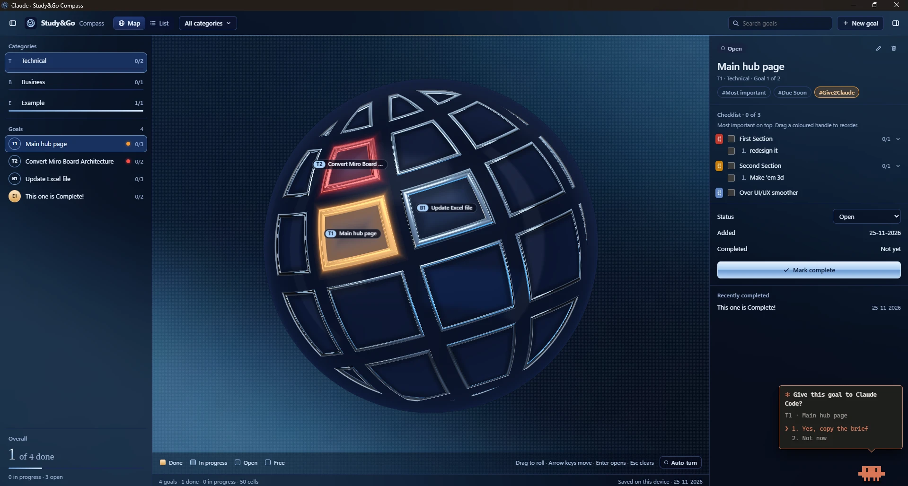

# Study&Go Compass

A goal tracker built around the Study&Go globe logo. Each cell on the globe holds one goal. The whole app is one HTML file. It has no dependencies and makes no network calls.

## How it works

The globe has 50 cells. Click an empty cell to put a goal there, then give it a title, a category you type yourself, a due date and a checklist. Drag the globe to roll it in any direction. Left alone, it keeps turning on its own.

A cell changes as the goal moves along:

- An open goal is a plain chrome cell.
- A goal in progress fills with solid Study&Go blue as its checklist gets ticked.
- A completed goal turns gold, and the app plays a short chime.

## Checklists

The order of a checklist is its priority. The item at the top matters most and the colour follows the position. Drag an item up or down to change its priority, and its sub-steps move with it. Sub-steps are numbered and fold away.

## Tags

A goal can carry three tags, and each one makes its cell pulse on the globe:

| Tag | Effect on the cell |
|---|---|
| `#Most important` | red glow, fast pulse |
| `#Due Soon` | light red glow, slower pulse |
| `#Give2Claude` | orange glow, slower pulse |

The List view shows the same goals as a table, with their tags.

## Handing a goal to Claude Code

The pixel crab in the bottom right of the details panel offers to give the selected goal to Claude Code. Say yes and the app copies a brief to the clipboard: the selected goal in full, plus the rest of the globe as context. Paste it into Claude Code.

## Run it

Download `index.html` and open it in a browser. The globe needs WebGL2, which current versions of Chrome, Edge, Firefox and Safari all have.

Goals are saved in the browser's local storage on your own machine. Nothing is sent anywhere, so a different browser or a different computer starts with an empty globe.

## Keyboard

| Key | What it does |
|---|---|
| Arrow keys | move between cells |
| Enter | open the selected goal |
| Escape | close what is open, or clear the selection |
| Arrow up / down on a checklist grip | move that item |
| Arrow left / right on a panel edge | resize the panel, Home resets it |

## Notes

- Dates are shown day first: DD-MM-YYYY.
- Both side panels collapse, and both drag wider from their inner edge. They open at their normal size every time.
- The globe is drawn by one WebGL2 fragment shader. The styles, the script, the background picture and the app icon are all inside `index.html`.
- The crab is a fan drawing in the style of the Claude Code mascot. This project is not affiliated with Anthropic.
