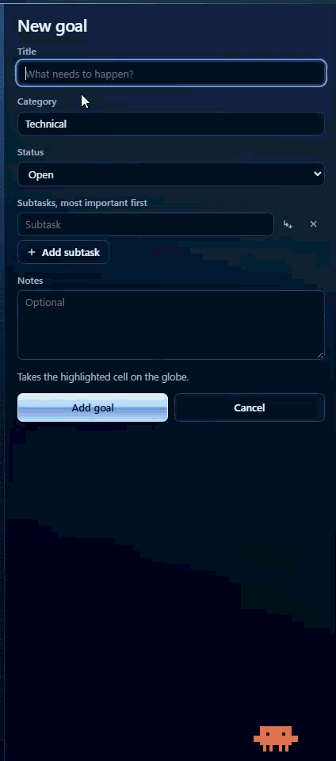
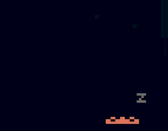
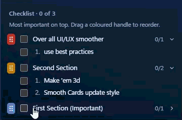
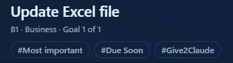
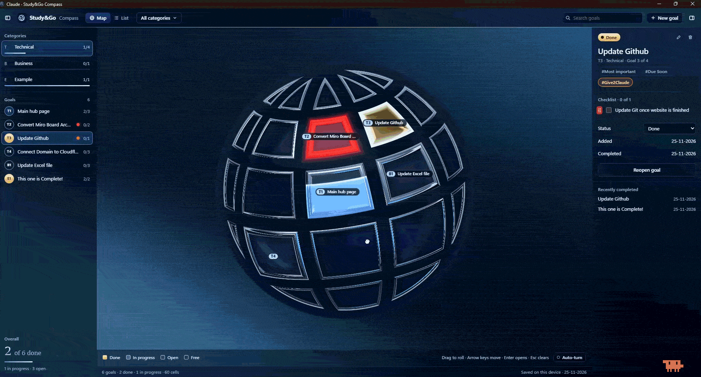

# Study&Go Compass

A goal tracker built around the Study&Go globe logo. Each cell on the globe holds one goal. The whole app is one HTML file.

Check it out: https://claude.ai/artifact/XVDvZnh6uE689MTBPf9MYo

## How it works

<table>
<tr>
<td width="260" valign="top">

</td>
<td valign="top">

#### The Compass with goals placed on the globe
The globe has 60 cells. Click an empty cell to put a goal there, then give it a title, a category you type yourself, a due date and a checklist.

Drag the globe to roll it in any direction. Left alone, it keeps turning on its own.

</td>
</tr>
<tr>
<td width="260" valign="top">

</td>
<td valign="top">

#### A cell changes as the goal moves along:

An open goal is a plain chrome cell.
A goal in progress fills with solid Study&Go blue as its checklist gets ticked.
A completed goal turns gold, and the app plays a short chime.

</td>
</tr>
<tr>
<td width="260" valign="top">

</td>
<td valign="top">

####  Feeling lazy? Give your task to Claude Code! 

Create your Goal, and copy & past it, into Claude Code within the application it self! It will copy your goal as your primary task and keep all the rest of your globe as background. 

</td>
</tr>
<tr>
<td width="260" valign="top">

</td>
<td valign="top">

#### Checklists

The order of a checklist is its priority. The item at the top matters most and the colour follows the position. Drag an item up or down to change its priority, and its sub-steps move with it. Sub-steps are numbered and fold away.

</td>
</tr>
<tr>
<td width="260" valign="top">

</td>
<td valign="top">

#### Tags

A goal can carry three tags, and each one makes its cell pulse on the globe:

Tag	Effect on the cell
#Most important	red glow, fast pulse
#Due Soon	light red glow, slower pulse
#Give2Claude	orange glow, slower pulse

The List view shows the same goals as a table, with their tags.

</td>
</tr>
</table>

## Final result:

## Prompts

The prompts used to build the Compass are in [PROMPTS.md](PROMPTS.md), in the order they were written.
